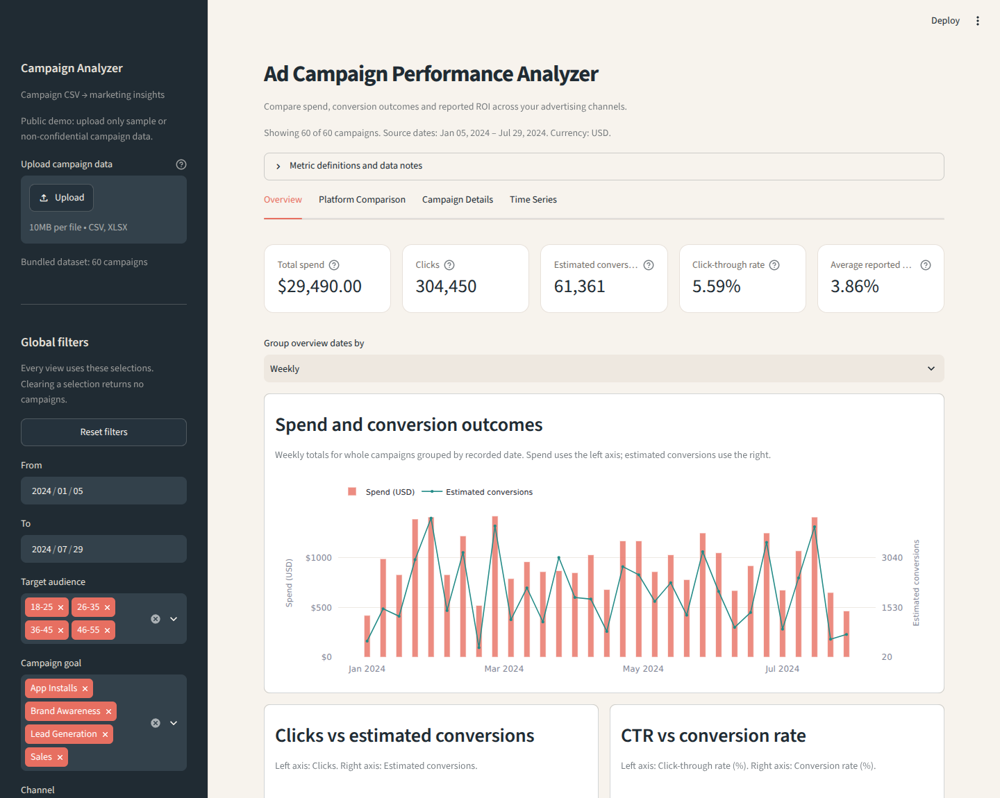

# Ad Campaign Performance Analyzer

A dashboard for exploring how advertising campaigns perform across Facebook, Instagram, Pinterest and Twitter. Compare spending and results, look at trends, and find the campaigns that stand out.

The app opens with a 60-campaign sample dataset. You can also upload your own CSV or Excel file.



## What you can do

- **Overview:** see the main metrics, spending trends and top campaigns.
- **Platform Comparison:** compare channels by spend, clicks, conversions, costs and reported ROI.
- **Campaign Details:** search individual campaigns, inspect their results and download the filtered table.
- **Time Series:** explore daily, weekly or monthly trends and compare channels over time.

Date, channel, audience, goal and customer segment filters apply across all four views. Use **Reset** to return to the full dataset.

## Run locally

Use Python 3.12. Clone this repository, open its folder, and run the commands for your system.

**Windows (PowerShell)**

```powershell
py -3.12 -m venv .venv
.\.venv\Scripts\python.exe -m pip install -r requirements.txt
.\.venv\Scripts\python.exe -m streamlit run app.py
```

**macOS or Linux**

```bash
python3.12 -m venv .venv
.venv/bin/python -m pip install -r requirements.txt
.venv/bin/python -m streamlit run app.py
```

Open the local address shown in the terminal and keep that terminal running while using the dashboard.

## Upload your data

Use the [sample CSV](data/social_media_advertising_sample.csv) as a template. Uploads can be UTF-8 CSV files or `.xlsx` workbooks, up to 10 MiB and 10,000 rows. For Excel, put the headers in the first row of the first worksheet.

These columns are required; their order can vary:

```text
Campaign_ID, Target_Audience, Campaign_Goal, Duration, Channel_Used,
Conversion_Rate, Acquisition_Cost, ROI, Location, Language, Clicks,
Impressions, Engagement_Score, Customer_Segment, Date, Company
```

Campaign IDs must be unique. Use dates such as `2024-01-05`, costs such as `420.50` or `$1,420.50`, and conversion rates such as `0.12` or `12%`. The app explains validation errors when a file needs correcting. Loading a new file resets the filters to its data range.

This is a public demo, so use sample or non-confidential data.

## How the metrics work

| Metric | Calculation |
| --- | --- |
| Spend | Total acquisition cost, in USD |
| Estimated conversions | Clicks × conversion rate, rounded for each campaign and then summed |
| CTR | Total clicks ÷ total impressions |
| CPC | Total spend ÷ total clicks |
| CPA | Total spend ÷ total estimated conversions |
| CVR | Total estimated conversions ÷ total clicks |
| Average reported ROI | Mean of the campaign ROI values |

Rates use the filtered totals. ROI follows the supplied solution kit's percentage convention: `3.2` is displayed as `3.20%`. Conversions are estimates, and ROI is the reported campaign average. Ratios with a zero denominator display `N/A`.

Each row represents a whole campaign. Time charts group campaign results by their recorded date; they do not represent daily ad delivery.

## Tests and deployment

Install `requirements-dev.txt` using the virtual-environment Python above, then run `-m pytest -q`. The test suite covers the analytics, uploads, filters and dashboard interactions. Results are recorded in [validation_report.md](validation_report.md).

For Streamlit Community Cloud, use branch `main`, entrypoint `app.py` and Python 3.12. No app secrets are required. See [DEPLOYMENT.md](DEPLOYMENT.md) for the setup and live checks. Deployment is pending.

The project uses Streamlit, pandas, Plotly and openpyxl. Its sample data and metric conventions come from the supplied Ad Campaign Performance Analyzer solution kit and dataset.
